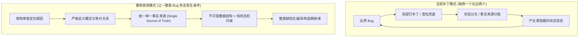
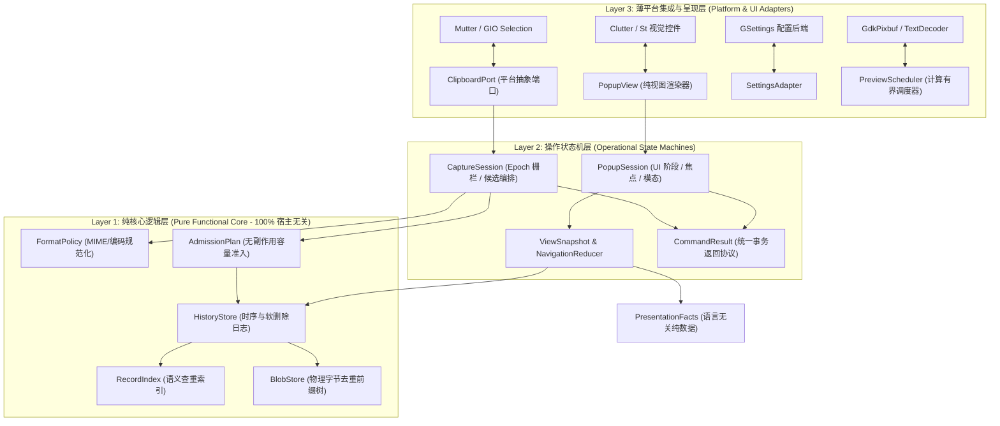
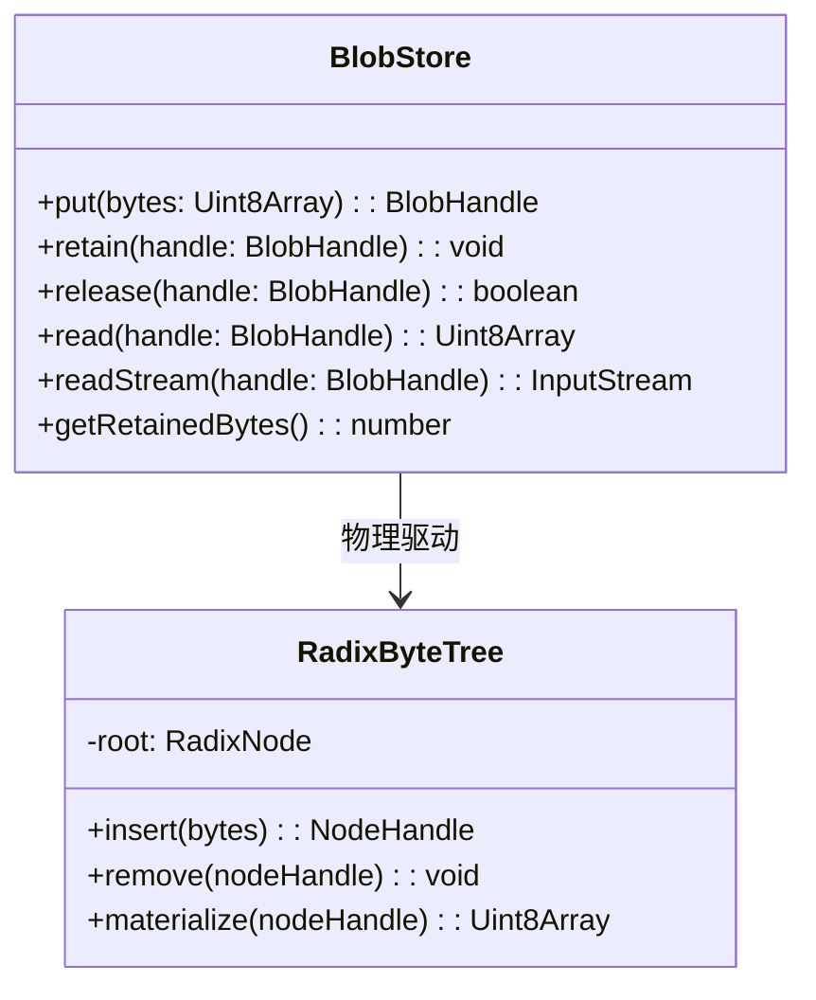
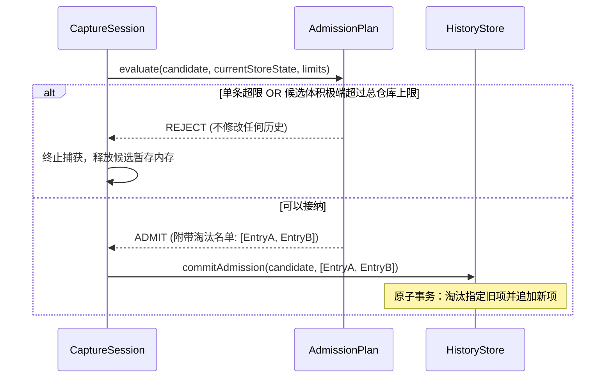
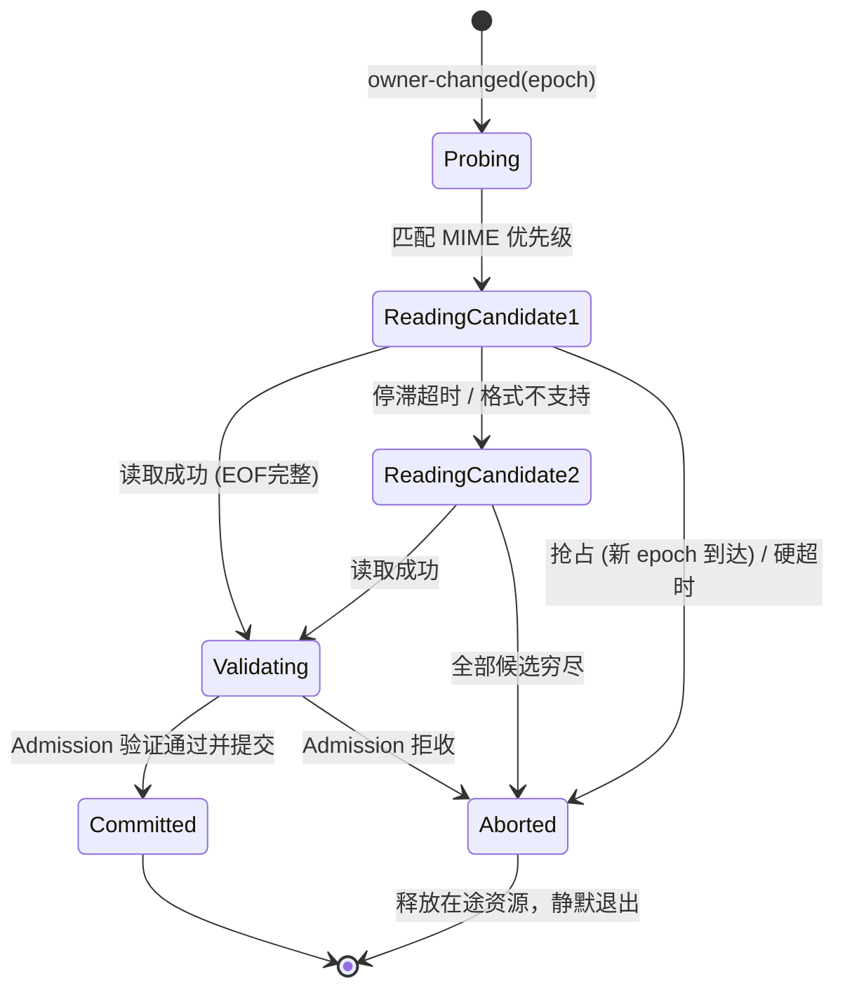
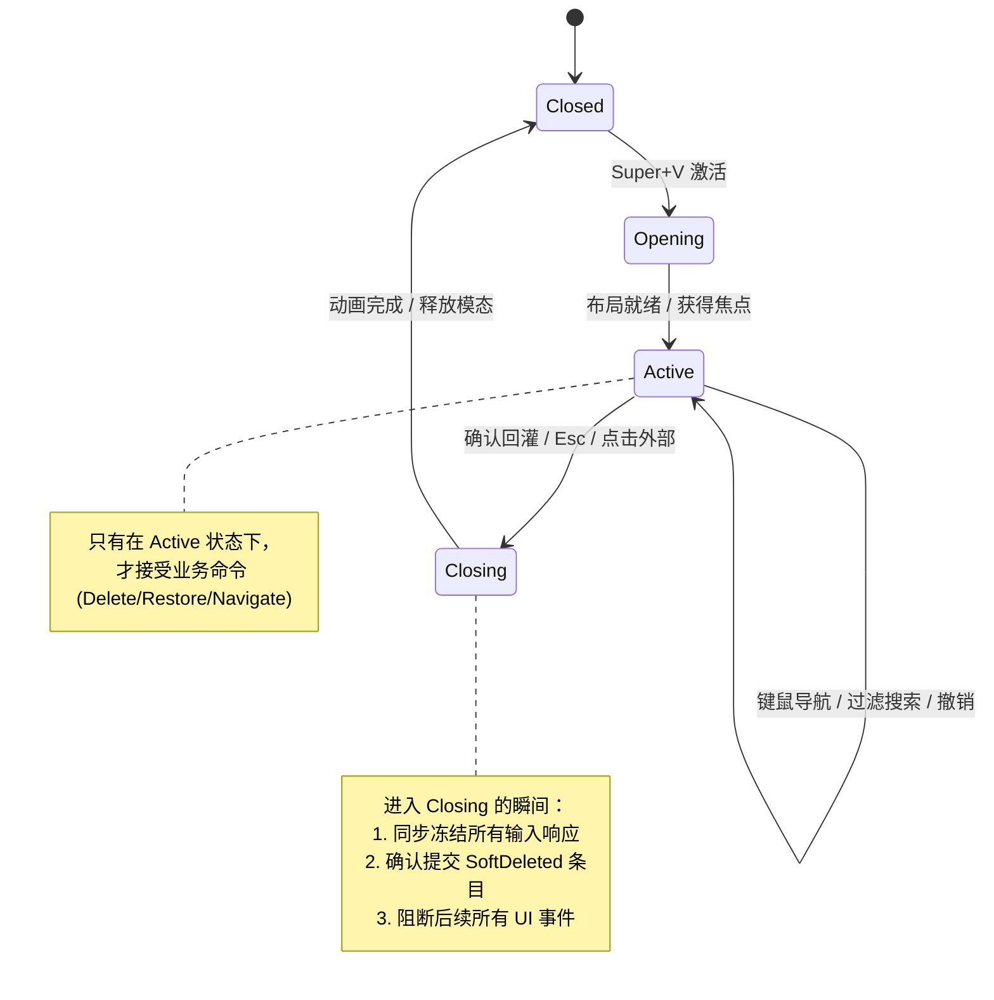
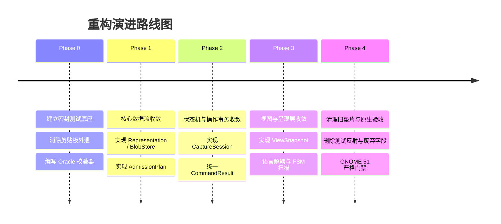

# Raw Clipboard 深度重构规范与无 Bug 架构设计白皮书
## —— 基于 Unix 哲学与状态模型收敛的零缺陷工程蓝图

> **文档版本**：v1.0 (Refactor Spec)  
> **基线快照**：v97 功能冻结版 (GNOME Shell 51 / Wayland)  
> **设计目标**：终结补丁膨胀，收敛事实来源；使一整类状态交错与时序缺陷在架构层面**失去发生条件**。

---

## 目录
1. [总则：何谓“无 Bug”与收敛方向](#1-总则何谓无-bug与收敛方向)
2. [分层架构模型：职责分离与三层边界](#2-分层架构模型职责分离与三层边界)
3. [第一层：纯核心逻辑层 (Pure Functional Core)](#3-第一层纯核心逻辑层-pure-functional-core)
   - 3.1 字节等价、表示等价与记录等价的严格分离
   - 3.2 Representation 实体与唯一真值源契约
   - 3.3 BlobStore（纯内容块存储）与所有权模型
   - 3.4 RecordIndex（语义去重索引）
   - 3.5 AdmissionPlan（无破坏性准入决策器）
   - 3.6 HistoryStore（单调递增时序与撤销日志）
4. [第二层：操作状态机层 (Operational State Machines)](#4-第二层操作状态机层-operational-state-machines)
   - 4.1 CaptureSession（采集会话与 Epoch 栅栏）
   - 4.2 PopupSession（弹窗生命周期与防重入栅栏）
   - 4.3 CommandResult（统一命令执行结果协议）
   - 4.4 ViewSnapshot & NavigationReducer（单一派生视图与纯函数导航）
5. [第三层：薄平台集成与呈现层 (Thin Platform Adapters)](#5-第三层薄平台集成与呈现层-thin-platform-adapters)
   - 5.1 ClipboardPort 与 Publisher（防回环与平台解耦）
   - 5.2 PresentationFacts & Localizer（数据与语言解耦）
   - 5.3 ResourceBudget & PreviewScheduler（计算有界与显式物化）
   - 5.4 SettingsAdapter & ApplyPolicy（配置真值与生效时机）
6. [技术债逐项清算与删除清单](#6-技术债逐项清算与删除清单)
7. [功能冻结下的去留决策与规则确认](#7-功能冻结下的去留决策与规则确认)
8. [验证体系与验收门禁标准](#8-验证体系与验收门禁标准)
   - 8.1 隔离测试端口（Fail-Closed）
   - 8.2 独立参考模型（Oracle Model Checking & Property Testing）
   - 8.3 故意破坏性反向变异验证（Mutation Testing）
   - 8.4 GNOME 51 原生独立验收
9. [阶段化重构演进路线图](#9-阶段化重构演进路线图)

---

## 1. 总则：何谓“无 Bug”与收敛方向

### 1.1 现实定位与认知底线
- **明确边界**：追求的不是“替整个 GNOME Shell、Mutter 或任意未知外部程序背书绝对不出错”，而是**“在明确规格的输入集合与生命周期内，核心状态机与数据流相对于形式化不变量是证明成立、没有未定义行为、并且在遭遇异常平台故障时安全收束的”**。
- **难点在于状态组合，而非代码行数**：
  Raw Clipboard 的核心代码虽然仅数千行，但却承受着：外部 MIME 与任意字节、异步多候选流竞争读取、停滞与硬超时取消、所有者抢占、历史去重与 LRU 提升、软删除与撤销、异步 UI 渲染与键鼠事件交错、缩略图延迟解码等状态的高频交叠。
- **根本出路**：
  **不再靠“发现一个特例，多加一层防御/正则/兜底”**，而是**通过统一数据表示与状态机，让一整类 bug 失去存在条件**。



---

## 2. 分层架构模型：职责分离与三层边界

按照 Unix 哲学“**一个模块只做一件事，并做到极致**”，整机架构彻底解耦为三个严格隔离的单向依赖层次：



### 层次隔离公理
1. **纯核公理**：第一层（Layer 1）必须为**纯 JavaScript**，零导入 `gi://*`，不依赖任何外部全局状态、事件循环或时钟。输入确定则输出绝对确定，可在 Node.js、浏览器或独立 Harness 中毫秒级执行 100% 确定性测试。
2. **状态机公理**：第二层（Layer 2）维护业务事务与会话生命周期。所有跨异步边界的调用必须携带所属 Session/Epoch 令牌；任何过期或已取消会话的回调被**硬件级阻断**，严禁渗透至第一层。
3. **薄适配公理**：第三层（Layer 3）只负责原生平台与第二层接口的双向翻译。它不维护任何业务历史数据库，不决定条目的去留或查重，失败时严格安全收束（Fail-Closed）。

---

## 3. 第一层：纯核心逻辑层 (Pure Functional Core)

### 3.1 三种相等关系的严格解耦

当前系统最核心的混乱根源，在于把三种截然不同的相等关系揉杂在同一套 Radix 树和 CMP1 容器中：

| 等价维度 | 形式化定义 | 负责实体 | 典型场景与反例 |
|---|---|---|---|
| **Blob Equality**（物理字节等价） | $\text{hash}(B_1) = \text{hash}(B_2) \land B_1 \equiv B_2$ | `BlobStore` | 两个不同 MIME 的条目恰好字节相同，物理内存共享，但**绝不影响彼此元数据**。 |
| **Representation Equality**（表示协议等价） | $M_1 \sim_{\text{canonical}} M_2 \land \text{Charset}(M_1) = \text{Charset}(M_2) \land B_1 \equiv B_2$ | `FormatPolicy` | `UTF8_STRING` 与 `text/plain;charset=utf-8` 等价；但 Latin-1 的 `e9` 与 CP1251 的 `e9` **绝对不等价**。 |
| **Record Equality**（历史条目等价） | $R_1.\text{representations} \equiv R_2.\text{representations}$ | `RecordIndex` | 两个历史记录是否为“同一次复制”，由已成功捕获的规范化表示集合严格判定。 |

> [!IMPORTANT]
> **黄金法则**：物理存储去重（BlobStore）只管节省 RAM，它没有“这是什么类型”的任何概念；语义去重（RecordIndex）只管记录是否重复，它完全不关心字节在底层如何分块压缩。

---

### 3.2 Representation 实体与唯一真值源契约

彻底废除 `candidates`、`core`、`formats`、`parts`、`textBytes`、`htmlBytes` 的散落状态。每个条目由 1 到 2 个（当前冻结上限）不可变的 `Representation` 构成：

```typescript
/** 不可变的单一媒体表示实体 */
export interface Representation {
    readonly id: string;               // 内部唯一标识
    readonly requestMime: string;      // 原始向外部程序请求的 MIME
    readonly canonicalMime: string;    // 经 FormatPolicy 规范化的标准 MIME (如 text/plain)
    readonly charset: string | null;   // 显式字符集 (如 utf-8, gbk, null)
    readonly role: 'text' | 'html' | 'image' | 'files' | 'raw';
    readonly blobHandle: BlobHandle;   // 底层物理内容强引用
    readonly byteLength: number;       // 字节大小
}

/** 不可变的历史记录条目 */
export interface Entry {
    readonly handle: EntryHandle;                  // 记录唯一句柄 (UUID / Symbol)
    readonly representations: readonly Representation[]; // 成功捕获并验证的表示清单 (长度 1 或 2)
    readonly defaultRepresentation: Representation; // 默认回灌表示
    readonly facts: PresentationFacts;             // 用于展示的纯数据事实（非本地化文案）
}
```

#### 不变量约束 (Invariants)
1. **所见即所存 (WYSIWYG)**：UI 上显示的每一个格式按钮，其对应的 `Representation` 在 Entry 中**百分之百存在且具有非空 BlobHandle**。严禁出现“按钮高亮但读取为 null”的异常分支。
2. **回放保真 (Replay Fidelity)**：回灌向系统剪贴板发布时，发布的 MIME 与字节必须与选定 `Representation` 完全一致。**绝对禁止从文本预览反向生成 HTML 或剥标签伪造回灌数据**。

---

### 3.3 BlobStore（纯内容块存储）与所有权模型

采用单棵 Radix 树作为底层字节存储引擎，但**剥离一切 MIME 兼容、别名索引与历史顺序逻辑**：



- **显式引用计数**：每个 `BlobHandle` 维护引用计数。Entry 创建时调用 `retain()`，Entry 被物理删除（或淘汰）时调用 `release()`。
- **精确计量**：`getRetainedBytes()` 严格统计 Radix 树实际占用的净字节数。引用归零时节点被向上剪枝合并，计数原子扣减。彻底根除因别名删除而导致的计数归零问题（消除 R01）。

---

### 3.4 RecordIndex（语义去重索引）

- 专门管理历史条目的去重识别，独立于物理存储。
- 计算 Entry 的 `semanticKey`：
  $$\text{SemanticKey} = \text{Sort}(\forall r \in \text{representations}: [r.\text{canonicalMime}, r.\text{charset}, \text{BlobHash}(r.\text{blobHandle})]).\text{join}(';')$$
- 当新复制到达时，直接查表匹配已有 Entry：
  - 若命中：仅触发 `HistoryStore.touch(existingHandle)`，执行 LRU 提升与时间刷新。
  - 若未命中：将新 Entry 登记入索引。
- 删除 Entry 时：**严格仅以该 Entry 自身的 `semanticKey` 注销**，绝不触碰任何其他具有相同字节或相近 MIME 的记录。

---

### 3.5 AdmissionPlan（无破坏性容量准入决策器）

彻底废除“先插进去入队、再按 FIFO 循环删除、删光旧的还不够再删新的”破坏性流程。



#### 形式化准入规约
给定候选记录 $C$、当前历史总有效大小 $S_{\text{current}}$、总配额 $L_{\text{total}}$、单条上限 $L_{\text{item}}$：
1. **硬性前置拒收**：
   $$\text{if } C.\text{size} > L_{\text{item}} \lor C.\text{size} > L_{\text{total}} \implies \text{REJECT}$$
   此时执行环境立即丢弃 $C$ 的临时缓冲，**历史记录与物理树状态严格不变**（消除 R06）。
2. **纯计算淘汰规划**：
   从历史队尾（最久未访问）向队首模拟扫描，累加需要腾出的空间 $\Delta = (S_{\text{current}} + C.\text{size}) - L_{\text{total}}$。
   计算产生必须淘汰的句柄列表 `evictList`。
3. **两阶段提交**：
   只有当规划验证成立，才执行物理淘汰与新项提交。

---

### 3.6 HistoryStore（单调递增时序与撤销日志）

- **双端时序维护**：
  历史队列以单调自增序列号 `revision: number` 驱动。每次插入、提升、删除均单调增加 `revision`。
- **软删除与撤销日志 (Undo Journal)**：
  - 用户在 UI 上按 Delete 时，条目首先进入 `JournalState.SoftDeleted`，同时将快照推入 `UndoStack`。
  - 若用户按撤销（Undo），条目原样恢复至原有顺序，其 `BlobHandle` 与 `Representation` 无需重新解析或分配。
  - 只有当 `PopupSession` 正常且成功关闭时，SoftDeleted 的条目才批量触发物理释放（`release` 并清理前缀树）。

---

## 4. 第二层：操作状态机层 (Operational State Machines)

### 4.1 CaptureSession（采集会话与 Epoch 栅栏）

每次系统剪贴板触发 `owner-changed` 时，产生一个唯一的自增 `epochId: number`：



#### Epoch 栅栏约束
在所有异步 `await` 恢复之后，必须同步检查：
$$\text{assert}(\text{this.currentEpoch} === \text{session.epochId} \land !\text{session.isCancelled})$$
若已过时，立即无条件中止，**绝对禁止迟到完成的数据向存储层注入**。

---

### 4.2 PopupSession（弹窗生命周期与防重入栅栏）

针对弹窗关闭期竞态、二次点击与按键交错，确立显式状态机：



---

### 4.3 CommandResult（统一命令执行结果协议）

所有交互入口（回车键、空格键、直接点击列表正文、点击左侧类型按钮、右键菜单项）统一向 Session 派发 Command，并接收强类型返回结果：

```typescript
export interface CommandResult {
    readonly status: 'APPLIED' | 'REJECTED' | 'FAILED';
    readonly shouldCloseWindow: boolean;
    readonly commitJournal: boolean;
    readonly errorMessage?: string;
}
```

#### 规则
1. **成功才关窗**：只有当 `status === 'APPLIED'` 时，UI 方可开启关闭动画。
2. **失败绝不误关**：若发布向系统剪贴板注入失败（例如 Mutter 返回异常），返回 `status: 'FAILED', shouldCloseWindow: false`。弹窗继续保持开启，**绝对不触发 SoftDeleted 条目的物理删除提交**（彻底根除 R09）。用户可以重新尝试或选择撤销。

---

### 4.4 ViewSnapshot & NavigationReducer（单一派生视图与纯函数导航）

彻底废除控件层各自记录 `selectedIndex`、`sortedEntries`、`_itemActors` 的分散维护：

```typescript
export interface ViewSnapshot {
    readonly historyRevision: number;    // 对应的历史版本
    readonly query: string;              // 当前有效搜索词
    readonly filteredEntries: readonly EntryHandle[]; // 过滤并排序后的条目列表
    readonly totalItems: number;         // 当前总条目数
    readonly pageIndex: number;          // 当前页码 (0-indexed)
    readonly totalPages: number;         // 总页数
    readonly selectedIndexInPage: number;// 当前选中的页内索引 (0..7)
    readonly selectedHandle: EntryHandle | null; // 当前强绑定的选中项
    readonly loopArmState: 'NONE' | 'ARMED_FORWARD' | 'ARMED_BACKWARD'; // 循环提示武装状态
}
```

- **纯函数导航 Reducer**：
  $$\text{NavigationReducer}(\text{prevSnapshot}, \text{Intent}) \implies \text{nextSnapshot}$$
- **UI 1-Way 投影**：
  UI 控件（`PopupView`）只作为纯渲染器。当收到新 `ViewSnapshot` 时，进行单向差异刷新（Diff Update）。控件没有自发修改选中状态的权力，彻底消除由于后台插入新条目导致的选择漂移与循环翻页提示残留。

---

## 5. 第三层：薄平台集成与呈现层 (Thin Platform Adapters)

### 5.1 ClipboardPort 与 Publisher（防回环与平台解耦）

- **单一发布通道**：
  发布操作由统一的 `Publisher` 执行，统一挂载 `RESTORE_NONCE` 符号及超时防御。
- **Fail-Closed 隔离设计**：
  在单元测试与隔离环境下，`ClipboardPort` 注入为完全受控的 Fake 适配器；原生 Mutter 的 `SelectionSourceMemory` 与 `St.Clipboard` 仅在真实桌面环境下由适配器动态桥接。

---

### 5.2 PresentationFacts & Localizer（数据与语言解耦）

- **数据只存事实**：
  Entry 的 `facts` 字段仅存储语言无关的基础属性：
  ```typescript
  export interface PresentationFacts {
      readonly isTextEmpty: boolean;
      readonly sampleTextPrefix: string;  // 原始前缀片段 (最多 256 字符)
      readonly fileListFacts?: {
          readonly totalCount: number;
          readonly dirCount: number;
          readonly firstTwoNames: readonly [string, string?];
          readonly isCapped: boolean;
      };
      readonly imageMime?: string;
  }
  ```
- **展示动态本地化**：
  在渲染前通过 `Localizer.project(entry.facts, uiLanguage)` 动态派生出当前需要的 `title` 与 `subtitle`。
  - 中文模式下输出：`等 3 个文件`；
  - 切换至英文立即变为：`and 2 other files`。
  Entry 内部永不残留“捕获时刻的翻译后字符串”（根除 R07），搜索索引严格在当前语言投影空间运行。

---

### 5.3 ResourceBudget & PreviewScheduler（计算有界与显式物化）

- **无二次指数回溯正则**：
  废除针对未知长文本的复杂正则替换。HTML 标签剥离采用严格的线性有限状态扫描器（FSM），时间复杂度严格限制在 $O(N)$，且单条扫描字节数硬性截断在 64 KiB。
- **显式 Blob 读取**：
  严禁通过 getter（如 `get bytes()`）隐式触发整块大内存拼接。所有大载荷访问必须调用显式异步方法 `blobStore.readStream(handle)`。
- **缩略图并发与状态收束**：
  `PreviewScheduler` 统一维护缩略图状态（`Pending` | `Ready` | `Failed`）。询问缩略图状态仅为哈希表查询，绝不重新物化完整图片数据（彻底根除 R10）。

---

### 5.4 SettingsAdapter & ApplyPolicy（配置真值与生效时机）

统一定义配置参数的生效策略矩阵：

| 配置项 | 默认值 | 作用域 | 生效时机 (ApplyPolicy) |
|---|---|---|---|
| `toggle-shortcut` | `['<Super>v']` | 全局快捷键 | 立即重新注册（注销旧的绑定新的） |
| `max-items` | `30` | 历史容量上限 | 立即触发一次历史检查，超出部分从队尾淘汰 |
| `max-size-mb` | `50` | 单条容量硬上限 | 对下一次新复制生效（不淘汰已有历史） |
| `max-total-size-mb`| `1024` | 存储树总容量 | 立即触发一次 `AdmissionPlan` 空间检查并平衡 |
| `inactivity-timeout-sec` | `5` | 慢源停滞超时 | 对下一次新建立的 `CaptureSession` 生效 |
| `overall-timeout-sec` | `15` | 单次传输总时限 | 统一归入 `CaptureSession` 初始化快照（废除在途动态监听） |
| `ui-language` | `'zh-CN'` | 界面语言 | 立即重新生成当前 `ViewSnapshot` 投影 |

---

## 6. 技术债逐项清算与删除清单

重构过程中，以下累赘逻辑、兼容垫片与重复维护者将被**物理彻底删除**：

| 现有文件/位置 | 废弃代码与冗余设计 | 删除理由 |
|---|---|---|
| `extension.js` | `decodeEscapedPreviewText` 及其所有调用 | 预览绝不篡改原始字节；真实 UTF-8 优先级由读取端保障。 |
| `extension.js` | CMP1 容器序列化/反序列化格式 | 改为直接使用 Representation 列表与 Blob 引用，无需内部打包协议。 |
| `extension.js` | 异常复合记录从 HTML 预览正则反解生成纯文本 payload | 严禁制造假数据，无效 Entry 在采集端直接拒收。 |
| `extension.js` | `_roots` 别名表与 `rootCount` | 单前缀树统一管理，不再伪装成“每个 MIME 一棵树”。 |
| `extension.js` | `iconBox` 上的代理属性（兼容测试按 children[0] 反射访问） | 生产代码绝不为了适应脆弱的旧测试而开后门。 |
| `extension.js` | `_readMimeStream` 废弃函数 | 无任何调用，死代码清理。 |
| `extension.js` | 隐式求值 `this.bytes` 的 getter | 昂贵操作必须显式，防止不知情物化大 payload。 |
| `extension.js` | `overallSettingsChangedId` 动态总体超时重设 | 超时参数在 Session 启动时锁定快照，消除在途时钟状态撕裂。 |

---

## 7. 功能冻结下的去留决策与规则确认

依据架构审查建议，在保持现有“功能完全冻结、对用户可见行为最小变动”原则下，确认以下规则底线：

1. **原样恢复原则**：
   用户选择哪个格式按钮，剪贴板就原汁原味提供该格式的原始字节流与 MIME。不进行任何形式的静默转码或编码降级。
2. **“复制文本”动作定义**：
   对富文本（HTML）或文件列表（Files）条目执行右键“复制文本”时：
   - 若 Entry 自身已包含纯文本表示（如 composite 条目），直接选用该纯文本 `Representation` 进行发布；
   - 若 Entry 为单纯文件列表，提取其 URI 文本流，以 `text/plain` 格式发布；
   - 坚决删除对任意二进制图片执行“伪文本提取”的无效菜单资格。
3. **KDE / Dolphin 剪切文件标记处理**：
   在 Linux Wayland 生态中，标准文件剪切由 `text/uri-list` 附带 `x-special/gnome-copied-files` (首行 `cut`) 或 `application/x-kde-cutselection` (`1`) 标明。
   统一由 `FormatPolicy` 解析判定，确认为 Cut 操作时一律予以安全拦截（保护用户文件剪切移动语义不被普通复制破坏）。
4. **日志脱敏与极简**：
   默认关闭系统日志输出。开启诊断日志时，仅输出事件类型、MIME、时间戳与字节大小，彻底移除在日志中计算 MD5 指纹的非必要开销。

---

## 8. 验证体系与验收门禁标准

要达到“可验证的无 Bug”标准，验证体系必须彻底脱离“测试全绿即可”的初级阶段，建立四重门禁：


### 8.1 隔离测试端口（Fail-Closed）
- 测试代码绝不直接或间接访问真实桌面的 `Meta.Selection` 或 `St.Clipboard`。
- 测试必须注入完全确定性的虚拟调度器（Fake Scheduler），可以精确控制毫秒级步进、乱序 Promise 解决与随机网络/I/O 挂起。

### 8.2 独立参考模型（Oracle Model Checking & Property Testing）
- 编写一个极其精简、代码量小于 150 行的**简易参考实现 (Reference Oracle)**，使用最直观的暴力数组存储与线性扫描。
- 采用基于性质的测试框架（Property-Based Testing），随机生成 100,000 次操作序列（并发采集、随机抢占、乱序超时、准入超限、软删除、撤销、翻页导航、语言切换）：
  $$\forall \text{OpSequence}: \text{HistoryStore}.\text{exportState}() \equiv \text{ReferenceOracle}.\text{exportState}()$$
  一旦发生状态不一致，测试自动收缩（Shrink）并输出最小可复现步骤。

### 8.3 故意破坏性反向变异验证（Mutation Testing）
- 对关键防护代码进行**故意剔除**测试：
  - 刻意注销 Epoch 校验：测试**必须立即失败**；
  - 刻意将发布失败直接执行关窗：测试**必须立即失败**；
  - 刻意在准入超限时清空已有历史：测试**必须立即失败**；
  - 刻意使参数化 MIME 交叉索引：测试**必须立即失败**。
- 证明测试断言具备真实的因果敏锐度，而非自欺欺人的“代码改坏依然全绿”。

### 8.4 GNOME 51 原生独立验收
- 在隔离的虚拟机/容器 GNOME 51 实际 Wayland 会话中，由实机测试运行器校验：
  - 真实模态窗口获取与失去焦点；
  - 48x48 像素图标的实际物理渲染与热区点击；
  - Firefox、GTK4、LibreOffice、文本编辑器之间的实际真实双向剪贴板粘贴与多类型协商。

---

## 9. 阶段化重构演进路线图

重构严禁采取“保留所有旧状态并试图一揽子重写”的冒险模式，必须按照依赖拓扑进行分阶段小步演进：



### 准入与交付标准
- **每个阶段结束时**：
  - 对应层次的所有核心不变量具备 100% 自动证明；
  - 原有 147 项功能用例逐一迁移至新架构测试套件，零功能回退；
  - 审查报告中列出的 11 个复现反例（R01～R11）在对应阶段完成时**从根源上被数学级消除**。

---

> **结语**：软件的可靠性源于清晰的边界与单一的事实。当概念不再分叉、状态不再有多个维护者、失败转换全部被类型安全收束时，“无 Bug”将不再是一句口号，而是一套可验证、可证明的工程事实。
